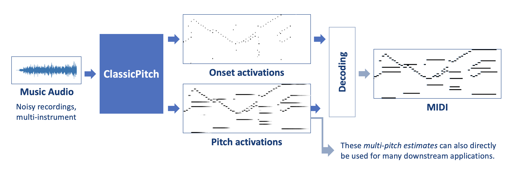
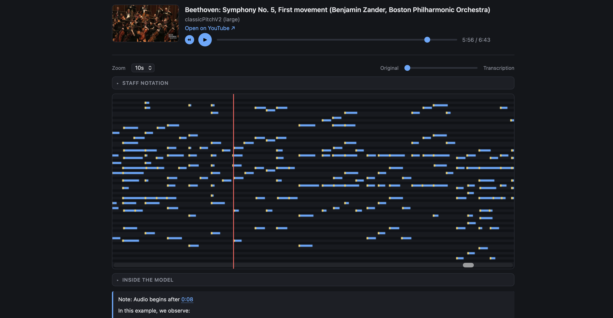

# ClassicPitch
Robust audio to MIDI transcription for musicology, based on this [paper](https://ismir2026program.ismir.net/poster_280.html#paper):

> Yannik Venohr and Christof Weiß. Robust Instrument-Agnostic Music Transcription for Western Classical Music. In *Proceedings of the International Society for Music Information Retrieval Conference (ISMIR)*, 2026.

This repository is for **using ClassicPitch** (and updates of it). For reproducing the paper and retraining, use the [paper repository](https://github.com/yannik-venohr/ismir26-classic-pitch).

<p align="center">
  
</p>

### What ClassicPitch does
- It transcribes pitched note events from an audio recording.
- It transcribes all instruments in a multi-instrument recording (e.g. orchestra).
- It transcribes note events between C1 and B6 in semitone resolution.
- It outputs MIDI and soft frame-wise pitch activations (multi-pitch estimates).

### What it does not do
- Detect voices or instruments. We know there is a C3, but not if it is played by a violin or a viola.
- Estimate tempo or meter. All note-events are in *physical* time. We know the C3 is played for 2.3 seconds, but not if it is a quarter or a third note.
- Detect the musical key. We don't know whether a note is a C# or a Db, since we assume enharmonic equivalence.
- Transcribe music that is not 12 tone equal temprament. Erverything is "snapped" to the closest semitone bin.

## Use it
### Requirements
```
pip install -r requirements.txt
```
### Get started

[`get_started.ipynb`](get_started.ipynb) is the quickest way in: load the model, transcribe a file, listen to the result, and plot the piano roll.

### Python
```python
import numpy as np
from classic_pitch import ClassicPitch

cp = ClassicPitch()
midi, outputs, times = cp.predict("data/example.wav")
midi.write("out.mid") # its a pretty_midi file
np.save('out_onset.npy', outputs['onset']) # onset activations, shape (72, n_frames)
np.save('out_frame.npy', outputs['frame']) # frame activations, shape (72, n_frames)
```
or via command line
```
python classic_pitch.py --audio data/example.wav --output out/example  # add --device cpu|cuda|mps to override
```

## Web demo

We provide browser apps (local Flask server) for trying out the model in an interactive way. You can transcribe pieces from youtube and visualize and sonify the transcription.
<p align="center">
  
</p>

| App | Description | Command | URL |
| --- | --- | --- | --- |
| ClassicPitch demo | Search on youtube or predict local files. Visualize and sonify the results. In this demo, we also provide some examples (right hand side) with comments on what works well and what does not.| `python webapp/demo/app.py` | http://127.0.0.1:5001 |
| Live microphone | Select an input and predict live (experimental) | `python webapp/live/app.py` | http://127.0.0.1:5004 |

The YouTube demo need [`ffmpeg`](https://ffmpeg.org/) on your `PATH`. 

Note that these browser apps were developed with heavy help of LLMs, therefore the code under `webapp` is not as carefully curated as the rest of the repo.


## Checkpoints
`checkpoints/` holds the following variants. Select one with `ClassicPitch(variant="classicPitch_small")`, `--variant`, or the model dropdown in the demo.

| Variant | Parameters | Description |
| --- | --- | --- |
| `classicPitch_large` | 1.06M | The ISMIR 2026 model, trained as described in the [paper](https://ismir2026program.ismir.net/poster_280.html#paper) and its [code](https://github.com/yannik-venohr/ismir26-classic-pitch). |
| `classicPitch_medium` | 289k | Smaller version of the above. |
| `classicPitch_small` | 48k | Smaller version of the above. |
| `classicPitch_extra_small` | 12k | Smallest version of the above, for fast or low-resource use. |
| `classicPitchV2_large` | 1.06M | Same architecture as `classicPitch_large`, trained with snapping as described in [this paper](https://www.audiolabs-erlangen.de/content/05_fau/professor/00_mueller/03_publications/2026_SahaBMM_SnappingMatters_ICMC.pdf) (Saha et al., ICMC 2026) and with engineering help of [Hans-Ulrich Berendes](https://www.audiolabs-erlangen.de/fau/assistant/berendes). |


## Credits
ClassicPitch builds on the work of many researchers in the MIR community, and we are grateful for their ideas and open-source contributions. Full references are given in the paper:
> Yannik Venohr and Christof Weiß. Robust Instrument-Agnostic Music Transcription for Western Classical Music. In *Proceedings of the International Society for Music Information Retrieval Conference (ISMIR)*, 2026.

The onset-peak and decoding logic in `src/postprocess/postprocess.py` is adapted from the code of [spotify/basic-pitch](https://github.com/spotify/basic-pitch) (Bittner et al., ICASSP 2022, Apache-2.0). The `predict()` interface is also modeled after theirs.

## License
[CC BY-NC 4.0](LICENSE): free for non-commercial use with attribution.
